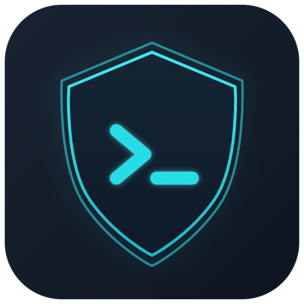
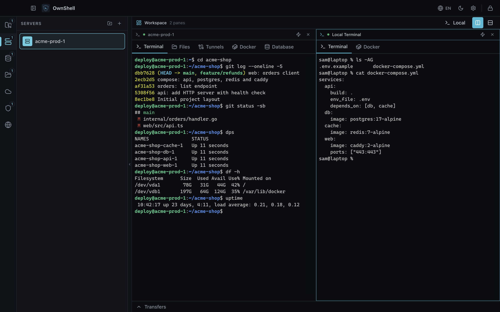
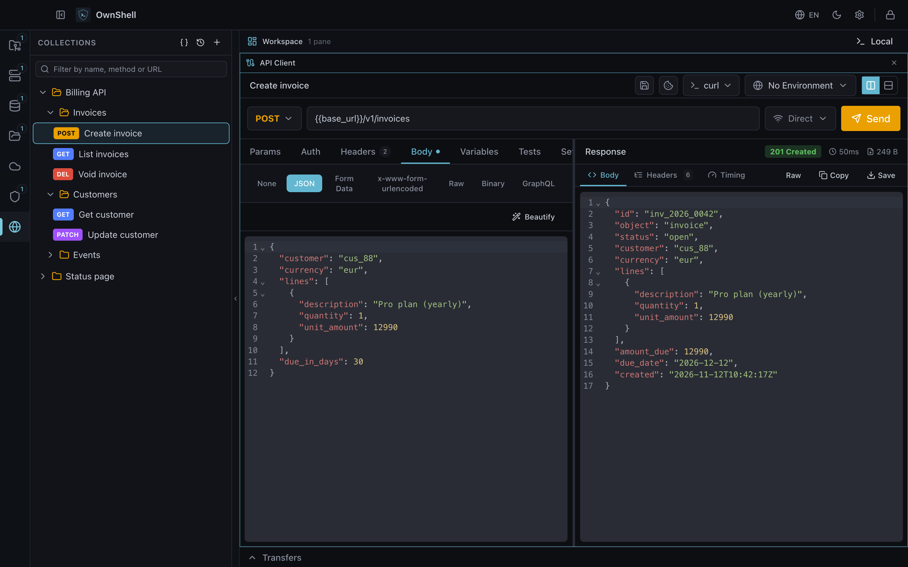
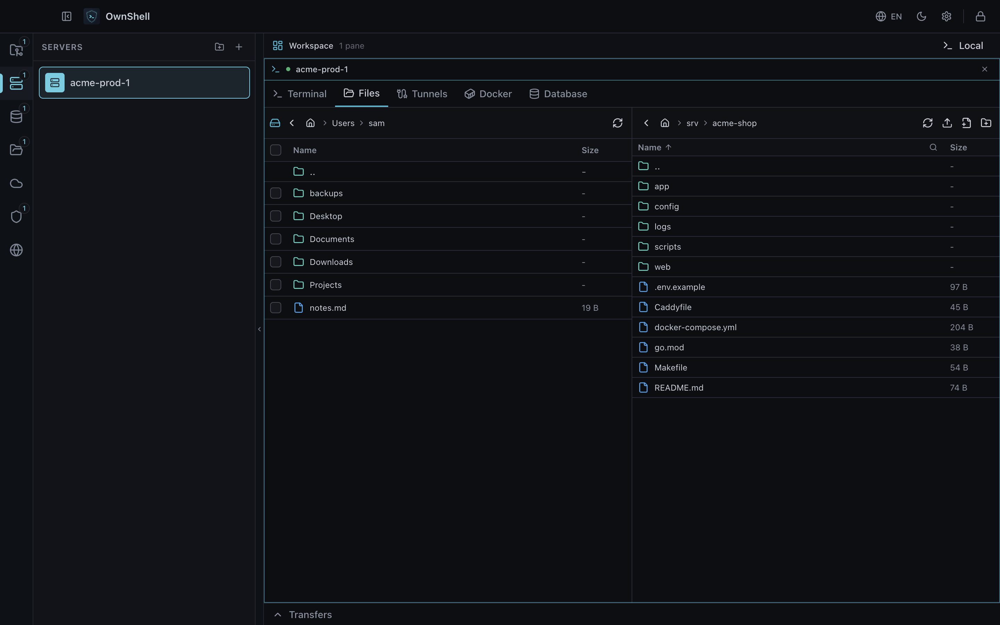
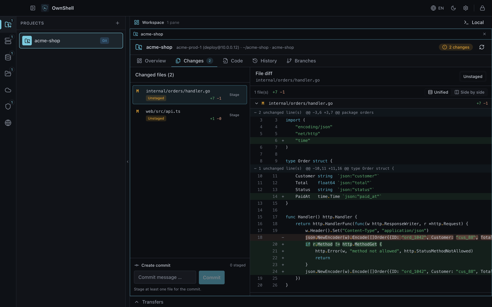
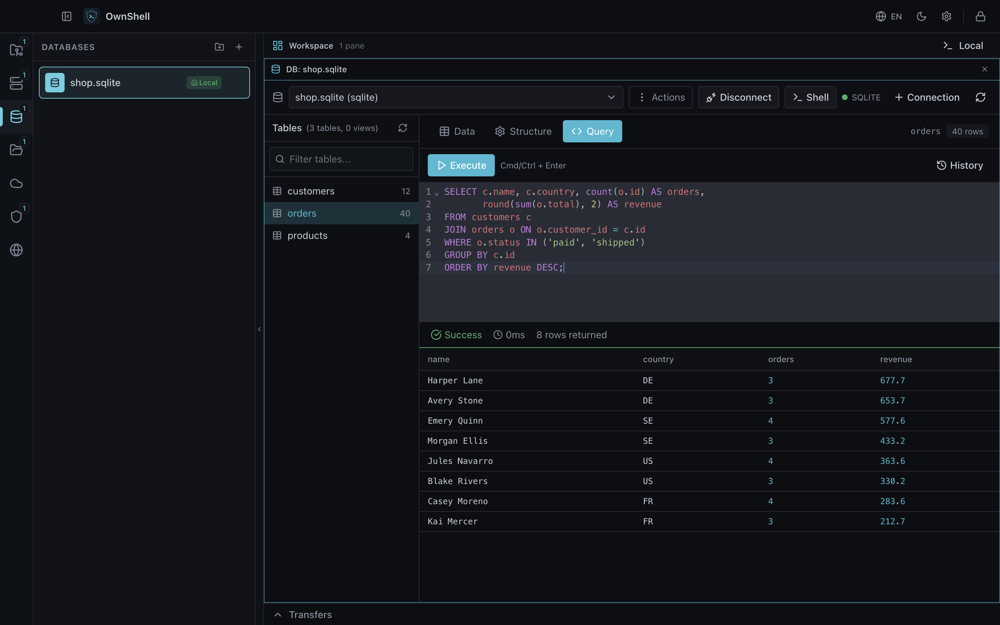

<p align="center">
  
</p>

<h1 align="center">OwnShell</h1>

<p align="center">
  <strong>Your servers, databases and APIs. One local workspace.</strong><br>
  A local-first desktop app for developers and small teams who run their own servers.
</p>

<p align="center">
  <a href="https://ownshell.app">Website</a> ·
  <a href="LICENSE">GPL-3.0 License</a>
</p>

---

OwnShell puts the tools you switch between every day into one app: SSH terminals, SFTP and S3 file
browsing, Docker, database clients, an encrypted vault for credentials and `.env` files, a REST/GraphQL
API client and a view of the Git repositories on your servers.

A typical flow: open a project, SSH into its server, call an internal API **through that server**,
then check the result in the database or in Docker — without copying credentials between five tools.

Everything is stored locally in an encrypted database. No account, no cloud sync, no telemetry.

<p align="center">
  
</p>

| | |
|---|---|
| <br>**API client**: collections, variables and timing | <br>**SFTP**: local and remote side by side |
| <br>**Projects**: Git status, code and diffs on your server | <br>**Databases**: tables and SQL queries |

## Features

**Terminals & SSH**
- Native OpenSSH terminals with split panes, plus a local terminal
- SSH keys, jump hosts (bastions) and one-click port forwarding / tunnels
- Host key verification (trust on first use) for every built-in SSH connection

**Files**
- Dual-pane SFTP browser with transfer queue and an editor with syntax highlighting
- S3-compatible storage (AWS S3, MinIO, …) incl. bucket CORS editor

**Docker**
- Containers, logs, shell access, images, networks and Compose projects over SSH

**Databases**
- PostgreSQL, MySQL, SQLite, Redis and MongoDB, optionally through an SSH tunnel
- SQL editor, data explorer, read-only connections

**Vault**
- Encrypted credentials and environment variables, grouped by project
- Upload an environment as a `.env` file to a server (written with owner-only permissions)

**API client**
- HTTP/REST, GraphQL, WebSocket and Server-Sent Events
- Requests can be sent **through an SSH host** to reach internal services
- Auth: Bearer, Basic, API key, OAuth 2.0 (client credentials, authorization code + PKCE), inheritance from folders
- Variables per request, folder, collection, environment (from the vault) and global; secrets stay encrypted
- Import curl and Postman collections/environments, copy as curl, portable `.ownshell-api.json` export
- Cookie jar, request history, collection runner with declarative assertions

**Projects / Git**
- Browse a repository on a server: code with syntax highlighting, diffs, history search, branches
- Compose project status next to the repository

**Backups**
- Encrypted export/import of your whole workspace

## Privacy & security

- Workspace data lives in a local SQLite database; secrets are encrypted with a key derived from your
  master password. The app locks automatically after a configurable idle time.
- No account and no automatic crash or analytics reports. OwnShell only talks to its own servers to
  check for and download updates.
- Connections go only to the servers, databases, buckets and APIs you configure.

## Download

Official builds for **macOS (Apple Silicon)** are available at [ownshell.app](https://ownshell.app).
OwnShell is free and open source: no price, no license key, no evaluation period and no account,
for private use and for work.

## Building from source

Requirements: Node.js 22, npm 10, macOS with Xcode Command Line Tools (native modules
`better-sqlite3`, `node-pty` and `ssh2` are rebuilt for Electron on install). Release packaging is
currently macOS arm64 only.

```bash
git clone https://github.com/SchildW3rk/OwnShell.git
cd OwnShell
npm ci

# Run the desktop app in development mode
npm run build --workspace=@ownshell/core
npm run build --workspace=@ownshell/ui
npm run dev:electron --workspace=ownshell-desktop

# Type-check and build the renderer/main bundles
npm run build:vite --workspace=ownshell-desktop

# Run the tests
npm test

# Regenerate the README/docs screenshots from local test fixtures (after build:vite)
node apps/desktop/scripts/screenshots/capture.cjs

# Package the macOS app into apps/desktop/release/ (signing needs your own Developer ID)
npm run build --workspace=ownshell-desktop
```

In development mode the database is seeded with sample data and the master password `dev123`.

## Repository layout

| Path | What |
|---|---|
| `apps/desktop` | Electron app — `src/` renderer (React), `electron/` main process, `scripts/` build helpers and tests |
| `apps/landing` | Website (ownshell.app) |
| `packages/core`, `packages/ui`, `packages/theme`, `packages/config` | Shared types, database schema, UI components and config |
| `docs` | User documentation (VitePress) |

Tech stack: Electron, React, TypeScript, Vite, Tailwind CSS, SQLite (better-sqlite3 + Kysely), ssh2, xterm.js, CodeMirror.

## Contributing

Issues and pull requests are welcome. Keep changes small and follow existing patterns. Before opening a PR,
run `npm run build:vite --workspace=ownshell-desktop` and `npm test`. See [`AGENTS.md`](AGENTS.md) for
repository conventions. By contributing, you agree that your contributions are licensed under the
GPL-3.0, the license of this project.

Security issues: please report them privately via GitHub's *Report a vulnerability* instead of a public issue.

## License

OwnShell is free software, licensed under the GNU General Public License v3.0 only (GPL-3.0-only).
See [LICENSE](LICENSE).
